# ⚡ AgentFlow — Enterprise Agent Workflow Builder & Deterministic Trace Runner

> **Deterministic Step Execution, Production Guardrails (Cost, Steps, Blocklists), and Human-in-the-Loop Approval for LLMOps & AI Engineering.**

[](LICENSE)
[](https://nodejs.org/)
[-003B57?logo=sqlite&logoColor=white)](https://nodejs.org/api/sqlite.html)
[-brightgreen)](#tech-stack)
[](CONTRIBUTING.md)
[](https://spmanchester.com)

---

### Built with ❤️ by [SPManchester Private Limited](https://spmanchester.com)
*Product #6 in SPManchester's AI Development Series — Developer-Facing AI Platform Engineering.*  
**Lead Architect & Author:** Sayed Mudassar Akbar  
**Corporate Inquiries & Enterprise Support:** [info@spmanchester.com](mailto:info@spmanchester.com) | [www.spmanchester.com](https://www.spmanchester.com)

---

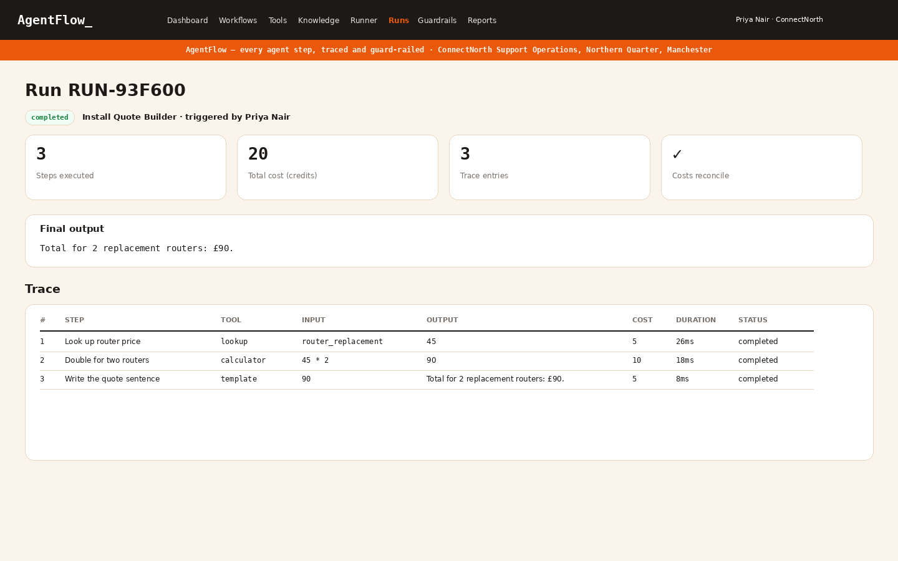

---

## 📌 Table of Contents

- [Overview & The Problem Solved](#-overview--the-problem-solved)
- [Architecture & Execution Flow](#-architecture--execution-flow)
- [Key Features](#-key-features)
- [Visual Console Tour](#-visual-console-tour)
- [Tool Registry & Contracts](#-tool-registry--contracts)
- [Deterministic Engine & Guardrail Rules](#-deterministic-engine--guardrail-rules)
- [Tech Stack](#-tech-stack)
- [Quick Start & Installation](#-quick-start--installation)
- [API Reference](#-api-reference)
- [CLI & Programmatic Usage](#-cli--programmatic-usage)
- [Docker Deployment](#-docker-deployment)
- [Verification & E2E Testing](#-verification--e2e-testing)
- [Production Seams & Roadmap](#-production-seams--roadmap)
- [About SPManchester Private Limited](#-about-spmanchester-private-limited)
- [License & Support](#-license--support)

---

## 🎯 Overview & The Problem Solved

Modern AI agent workflows often degrade into brittle, untestable glue code:
1. **Opaque Execution:** Chained prompts execute in obscure scripts. When a step produces corrupt output or consumes excess credits, diagnosing the failure post-hoc is impossible.
2. **Runaway Resource Consumption:** Without strict spend ceilings and step limits, looping or failing workflows silently drain budgets until discovered by infrastructure bills.
3. **Fragile Human-in-the-Loop Interventions:** Real-world operations require human sign-off for critical actions (e.g. refunds, escalation dispatches). Existing engines either block threads synchronously or skip human oversight entirely.
4. **Lack of Deterministic Replay:** "It worked yesterday" cannot be systematically verified if tool outputs, execution durations, and step costs fluctuate unpredictably.

### The AgentFlow Solution

**AgentFlow** replaces prompt chaos with an explicit, contract-driven execution engine:
- **Every step is traced:** Outputs, resolved inputs, duration counters, and execution costs are logged in an immutable trace table.
- **Trace costs reconcile mathematically:** Step expenditures sum up exactly to the total run cost on 100% of runs.
- **Pre-step guardrails enforce safety:** Max step limits, budget ceilings, and blocked tool lists halt dangerous runs before offending steps execute, preserving accumulated spend.
- **Stateful pause & resume:** Approval steps halt runs in an `awaiting_approval` state. Supervisors inspect the pending step and resume execution via REST API with zero loss of execution context.
- **Zero runtime dependencies:** Built purely on Node.js 22+ built-in modules (`node:http`, `node:sqlite`, `node:crypto`).

---

## 🏗️ Architecture & Execution Flow

AgentFlow decouples workflow definition from deterministic execution. Workflows exist as ordered tool configurations, while the runner threads state and enforces guardrail checks sequentially.

### Engine Execution Pipeline

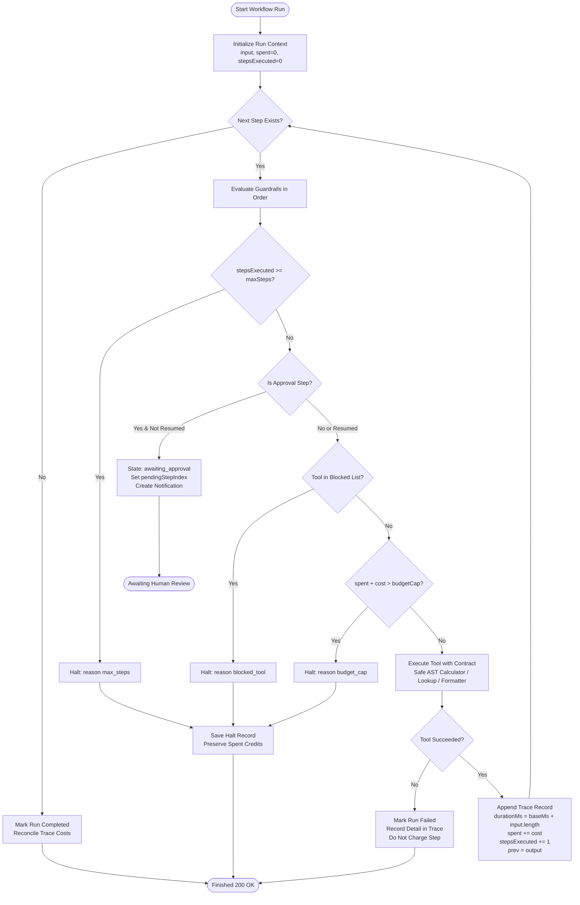

### Human-in-the-Loop Approval Lifecycle

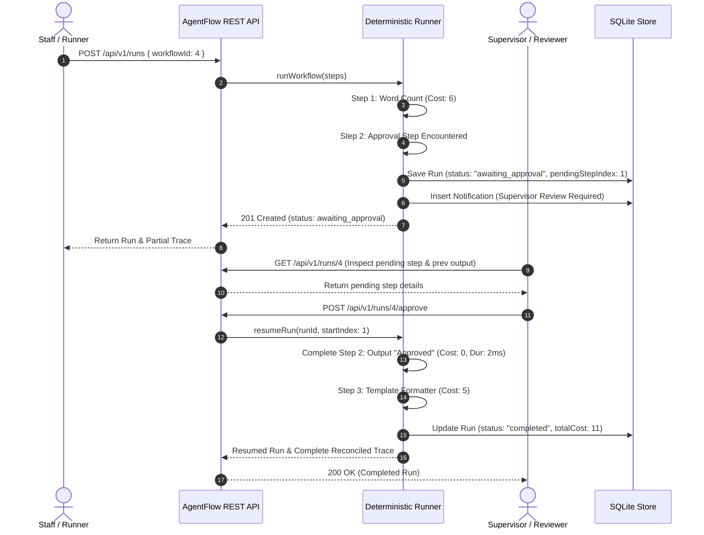

---

## ⚡ Key Features

- **100% Deterministic Trace Engine:** Durations follow exact, hand-verifiable counters (`tool.baseMs + resolvedInput.length`), ensuring replays produce identical durations, costs, and outputs.
- **AST-Based Calculator (Zero `eval()`):** Recursive-descent parser supporting `+ - * / %`, parentheses, unary minus, and `{prev}`/`{input}` substitution. Rejects letters and arbitrary code characters immediately.
- **Granular Multi-Stage Guardrails:** Workspace guardrails (max steps, budget ceiling, blocked tool registry) are checked before step execution, preserving accumulated spend.
- **Stateful Human-in-the-Loop:** Seamless pause/resume engine with notification dispatch for supervisor review.
- **Contract-Driven Tool Registry:** 6 core tools with documented input/output schemas:
  - `calculator`: Safe arithmetic evaluation.
  - `lookup`: Scoped workspace knowledge retrieval.
  - `text_format`: String transformations (`uppercase`, `lowercase`, `title`, `trim`).
  - `word_count`: Exact token/word count analysis.
  - `date_add`: ISO 8601 UTC date manipulation with signed day offsets.
  - `template`: Structured mustache-style placeholder injection.
- **Mathematical Trace Reconciliation:** Every run reports `costsReconcile: true` verifying step sum equality.
- **Multi-Tenant Workspaces & RBAC:** Complete data scoping across `Owner` (full administrative rights) and `Staff` (operational execution) roles.
- **Pure Zero-Dependency Stack:** Zero external runtime packages. Standard Node.js library only.

---

## 🖼️ Visual Console Tour

The AgentFlow web console is a responsive, dependency-free SPA featuring 10 views calling the real REST API:

| View | Screenshot | Description |
|---|---|---|
| **01. Operations Dashboard** | 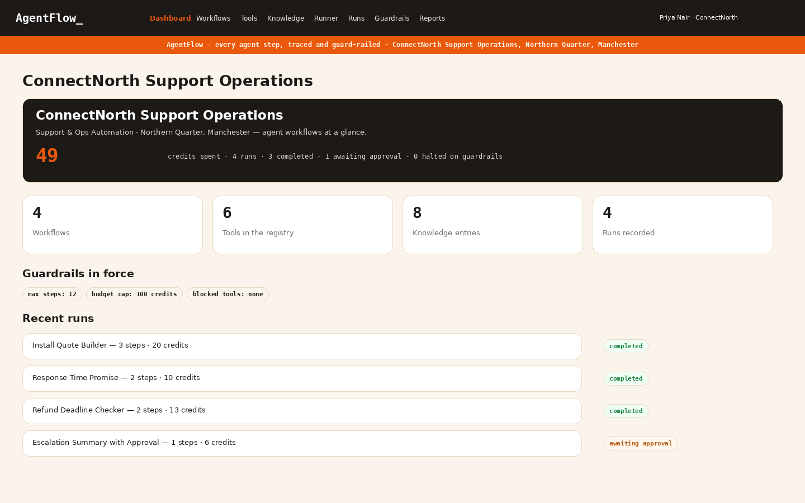 | High-level workspace telemetry: total workflows, executed runs, aggregate spend, and status distributions. |
| **02. Workflow Registry** | 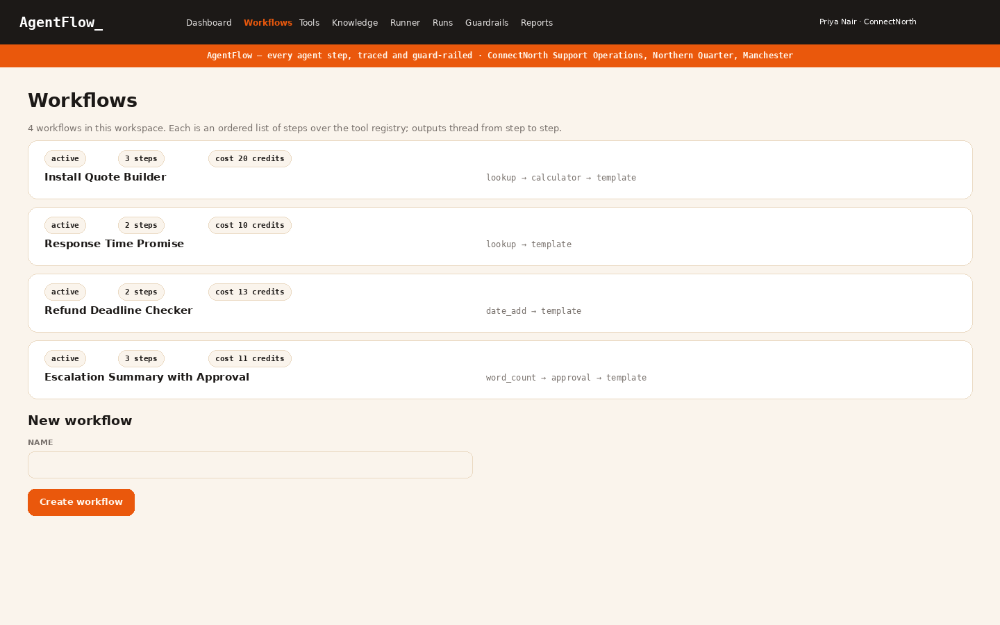 | Catalog of active, draft, and archived workflows with step counts and estimated execution costs. |
| **03. Workflow Builder** | 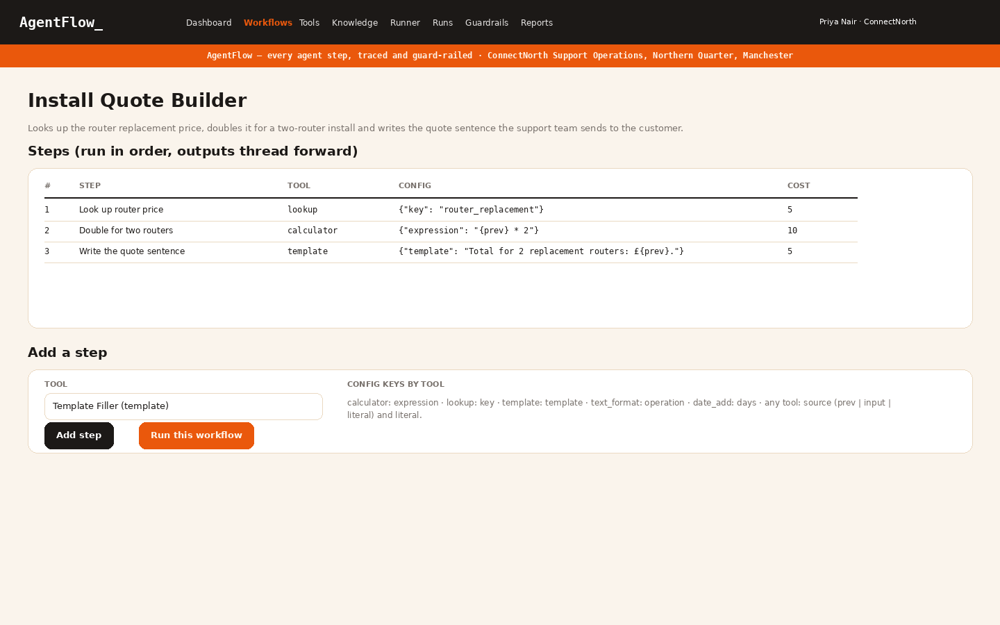 | Visual step pipeline builder for sequencing tools, setting data sources, and inserting approval pauses. |
| **04. Tool Registry** | 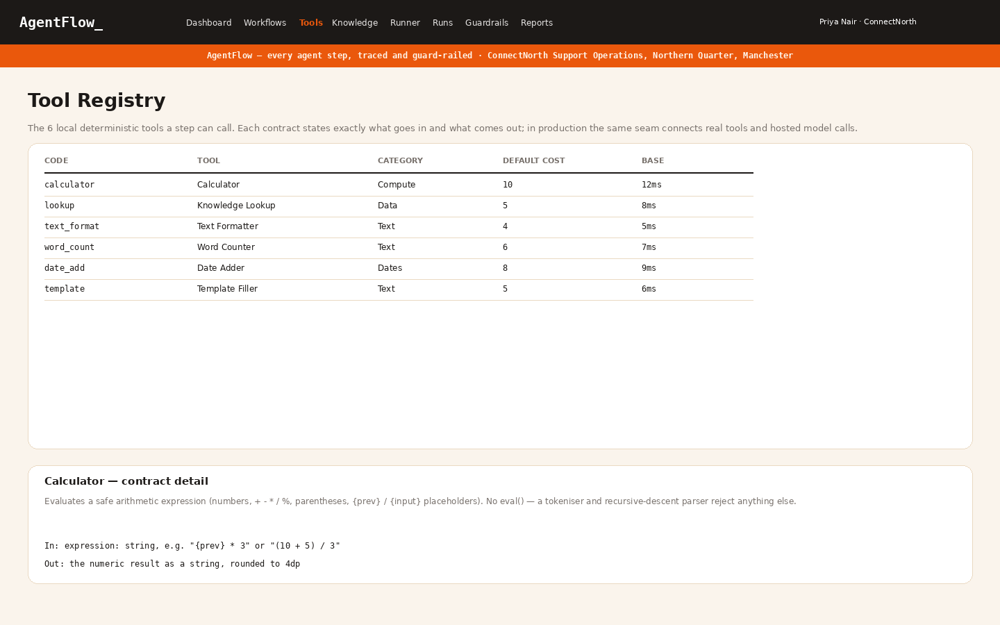 | Documented registry contracts, base execution latencies, and default credit costs. |
| **05. Knowledge Table** | 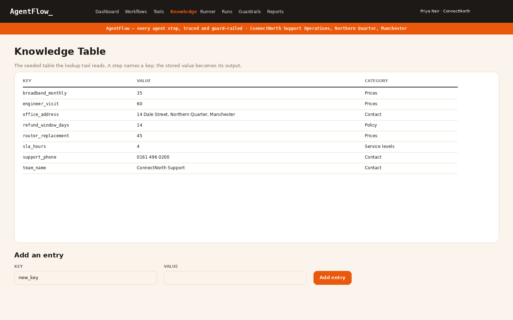 | Scoped key-value storage queried by the `lookup` tool during workflow runs. |
| **06. Execution Runner** | 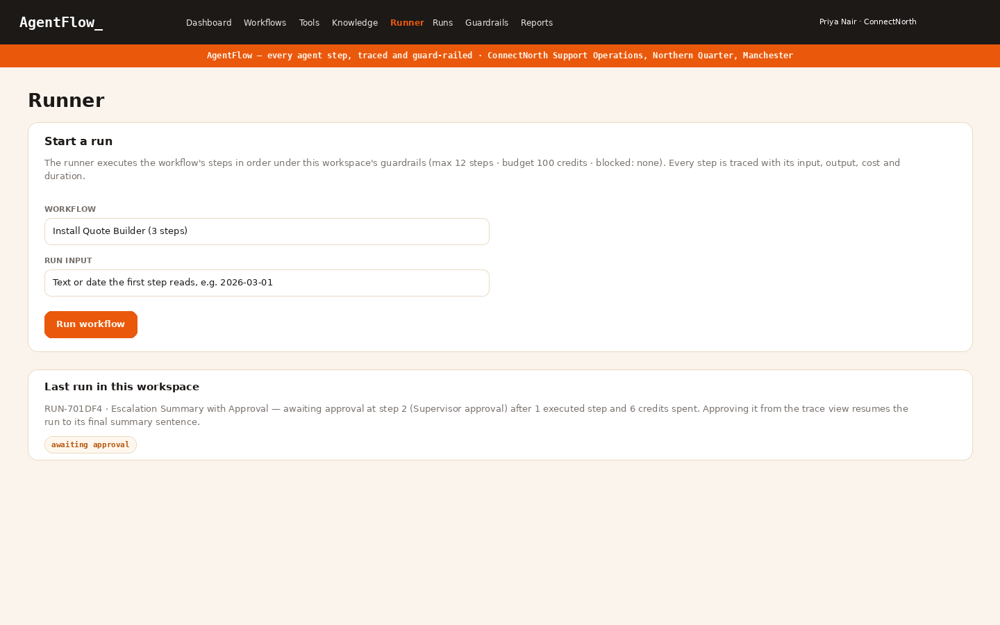 | Interactive workflow execution console with runtime parameter injection. |
| **07. Run History** | 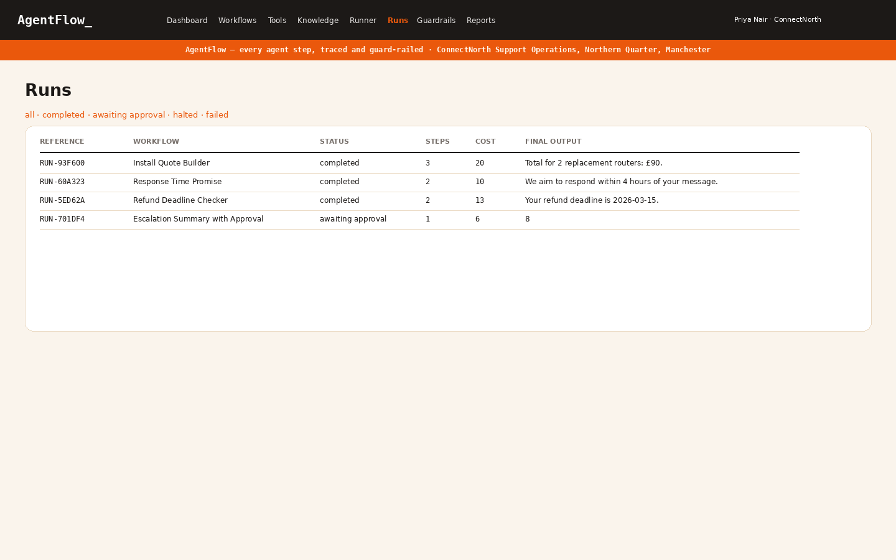 | Filterable run audit log with status filters (`completed`, `awaiting_approval`, `halted_guardrail`, `failed`). |
| **08. Deterministic Trace** |  | Step-by-step trace inspection detailing resolved inputs, outputs, costs, and mathematical reconciliation. |
| **09. Guardrails Config** | 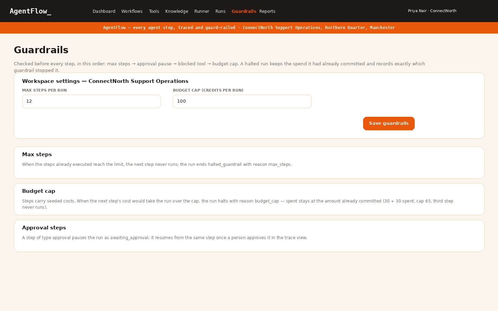 | Workspace policy configuration: budget caps, maximum step limits, and tool blocklists. |
| **10. Reports & Help** | 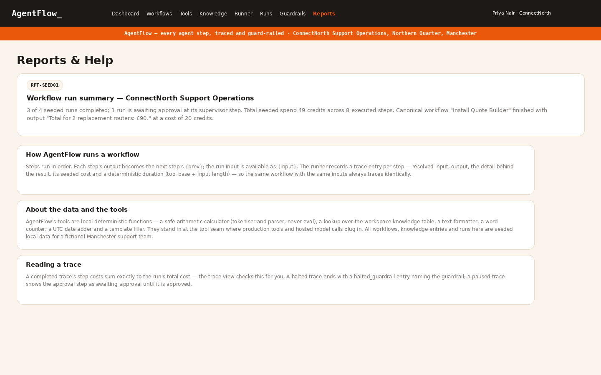 | Formatted operational summary reports and built-in interactive platform documentation. |

---

## 🔧 Tool Registry & Contracts

Every tool in AgentFlow implements an explicit contract with documented costs and baseline latency counters:

| Tool Code | Description | Input Contract | Output Contract | Default Cost | Base Duration |
|---|---|---|---|---|---|
| `calculator` | Safe arithmetic evaluation | Expression string, e.g. `"{prev} * 2"` | Formatted number string (4dp, trimmed) | 10 credits | 12 ms |
| `lookup` | Workspace knowledge lookup | Knowledge key (`config.key`) | Stored key value string | 5 credits | 8 ms |
| `text_format` | Text case and whitespace formatting | Input string; operation in `[upper, lower, title, trim]` | Formatted string | 4 credits | 5 ms |
| `word_count` | Whitespace-separated word counter | Input string | String count of words | 6 credits | 7 ms |
| `date_add` | UTC date math | `YYYY-MM-DD` date; signed integer `config.days` | Resulting `YYYY-MM-DD` date string | 8 credits | 9 ms |
| `template` | Variable injection | Template with `{prev}` and `{input}` tokens | Interpolated string | 5 credits | 6 ms |

---

## 🛡️ Deterministic Engine & Guardrail Rules

### Deterministic Duration Model (EB-1)
To ensure reliable audit replays across different operating environments, execution duration is not tied to host CPU wall-clock jitter. Instead, it follows a strict deterministic counter:
$$\text{durationMs} = \text{tool.baseMs} + \text{length}(\text{resolvedInput})$$

### Pre-Step Guardrail Evaluation Order (FR-7)
Before any step executes, the engine verifies workspace policies in this exact order:
1. **Max Steps:** If `stepsExecuted >= maxSteps`, the run halts immediately (`halted_guardrail`, reason: `max_steps`).
2. **Approval:** If the step is an `approval` type and not yet approved, execution pauses (`awaiting_approval`).
3. **Blocked Tools:** If `step.toolCode` exists in `workspace.blockedTools`, the run halts (`halted_guardrail`, reason: `blocked_tool`).
4. **Budget Cap:** If `spentCredits + stepCost > budgetCap`, the run halts (`halted_guardrail`, reason: `budget_cap`).

In all halt events, previously incurred spend is strictly preserved in the database.

---

## 💻 Tech Stack

| Layer | Technology | Rationale |
|---|---|---|
| **Runtime** | Node.js >= 22.5.0 | High-performance async I/O with built-in standard library support. |
| **HTTP Routing** | `node:http` | Pure, dependency-free router with zero external overhead. |
| **Database** | `node:sqlite` | Built-in SQLite database engine; zero native build dependencies. |
| **Security** | `node:crypto` | Enterprise scrypt password hashing and crypto token generation. |
| **Frontend** | Vanilla ES6 & CSS3 | Zero-bundle SPA console; hash-based client routing, pure CSS grid. |
| **Containerization**| Docker & Alpine Linux | Lightweight multi-stage production deployment container (~120MB). |

---

## 🚀 Quick Start & Installation

### Prerequisites
- **Node.js:** `v22.5.0` or higher ([Download Node.js](https://nodejs.org/))
- **Git**

### 1. Clone the Repository
```bash
git clone https://github.com/serviceprovidermanchester/spm-aidev-agentflow.git
cd spm-aidev-agentflow
```

### 2. Configure Environment
```bash
cp .env.example .env
```

### 3. Start the Server
```bash
npm start
```
The server will start at `http://127.0.0.1:4000/`.  
Open your browser to explore the Web Console.

### 4. Verify Health
```bash
curl http://localhost:4000/health
```

---

## 📖 API Reference

AgentFlow exposes 26 REST endpoints under `/api/v1` alongside the root `/health` probe:

### System & Authentication
- `GET /health` — System status, database health, loaded tools, and knowledge statistics.
- `POST /api/v1/auth/register` — Create a new owner account and private workspace.
- `POST /api/v1/auth/login` — Sign in and obtain a bearer token session.
- `POST /api/v1/auth/logout` — Invalidate current session token.
- `GET /api/v1/auth/me` — Retrieve authenticated user profile and workspace permissions.
- `PUT /api/v1/auth/me` — Update user profile details.

### Workspace & Guardrails
- `GET /api/v1/project` — Fetch workspace details and active guardrail settings.
- `PUT /api/v1/project` — Update guardrails (`maxSteps`, `budgetCap`, `blockedTools`) *(Owner only)*.
- `GET /api/v1/dashboard` — Workspace summary metrics, spend analytics, and run status distribution.

### Tools & Knowledge Base
- `GET /api/v1/tools` — List all registered tools with contracts, costs, and base durations.
- `GET /api/v1/tools/:code` — Retrieve specific tool contract specification.
- `GET /api/v1/knowledge` — List workspace knowledge entries.
- `POST /api/v1/knowledge` — Add an entry (`key`, `value`, `category`).

### Workflow Management
- `GET /api/v1/workflows` — List all workflows with step configurations.
- `POST /api/v1/workflows` — Create a workflow with ordered steps.
- `GET /api/v1/workflows/:id` — Retrieve workflow definition and step details.
- `PUT /api/v1/workflows/:id` — Update workflow name, description, or status (`draft`, `active`, `archived`).
- `POST /api/v1/workflows/:id/steps` — Append an ordered step.
- `DELETE /api/v1/workflows/:id/steps/:stepId` — Remove a step from a workflow.

### Execution & Trace Runner
- `GET /api/v1/runs` — Query run history (filterable by `workflowId` and `status`).
- `POST /api/v1/runs` — Start a workflow run with runtime input.
- `GET /api/v1/runs/:id` — Get comprehensive run details with full reconciled step trace.
- `POST /api/v1/runs/:id/approve` — Resume a run paused at an approval step.

### Reports & Notifications
- `GET /api/v1/reports` — List generated run summary reports.
- `POST /api/v1/reports` — Generate a formal report for a specific run.
- `GET /api/v1/notifications` — View user notifications (approval alerts, guardrail halts).
- `PATCH /api/v1/notifications/read` — Mark notifications as read.

---

## 💻 CLI & Programmatic Usage

### 1. Authenticate via cURL
```bash
curl -X POST http://localhost:4000/api/v1/auth/login \
  -H "Content-Type: application/json" \
  -d '{"email":"owner@connectnorth.co.uk","password":"Owner2026!"}'
```

### 2. Trigger a Workflow Run
```bash
curl -X POST http://localhost:4000/api/v1/runs \
  -H "Authorization: Bearer <YOUR_TOKEN>" \
  -H "Content-Type: application/json" \
  -d '{"workflowId": 1, "input": ""}'
```

### 3. Resume an Approval Step
```bash
curl -X POST http://localhost:4000/api/v1/runs/4/approve \
  -H "Authorization: Bearer <YOUR_TOKEN>"
```

---

## 🐳 Docker Deployment

Run AgentFlow in an isolated Alpine container with persistent SQLite storage:

### Using Docker Compose
```bash
docker compose up -d
```

### Using Plain Docker
```bash
docker build -t spmanchester/agentflow:latest .
docker run -d -p 4000:4000 --name spm-agentflow spmanchester/agentflow:latest
```

---

## 🧪 Verification & E2E Testing

AgentFlow includes an end-to-end HTTP test harness executing against a fresh SQLite database:
- **50 Automated Checks:** Validates authentication, RBAC scoping, builder mutations, and guardrails.
- **22 Hand-Verified Fixtures:** Exact mathematical assertions computed independently of the engine:
  - Canonical quote chain: `45 * 2 = £90` for 20 credits.
  - Guardrail halts: 30+30 spend at cap 65 halts at index 2 with 60 spent.
  - AST calculator rejection: `2 + process.exit()` rejected character-by-character.
  - Mathematical cost integrity: sum of trace steps equals run total on every run.

Run the test suite:
```bash
npm test
```

---

## 🗺️ Production Seams & Roadmap

AgentFlow is architected with clear seams for production expansion:
- **Hosted Model Steps:** Direct integration with OpenAI, Anthropic Claude, Google Gemini, and Azure OpenAI behind the standard tool contract seam.
- **Enterprise Tool Connectors:** Live connectors for CRM (Salesforce, HubSpot), Slack/Teams alerting, payment processors (Stripe), and internal relational databases.
- **Advanced Control Flow:** Conditional branching (`if/else`), fan-out parallel steps, and looping constructs.
- **Multi-Party Approval Quorums:** Multi-stakeholder sign-off policies with timeout escalations.
- **Export & Analytics:** Automated trace telemetry export into Datadog, OpenTelemetry, and Prometheus.

---

## 🏢 About SPManchester Private Limited

**SPManchester Private Limited** is an engineering and AI solutions provider delivering enterprise-grade software, AI platforms, and digital transformation architectures worldwide.

- **Website:** [https://www.spmanchester.com](https://www.spmanchester.com)
- **General Inquiries:** [info@spmanchester.com](mailto:info@spmanchester.com)
- **Headquarters:** Manchester, United Kingdom
- **Portfolio:** Explore our complete suite of software, mobile, and developer-facing AI platforms.

---

## 📄 License & Support

This project is licensed under the **MIT License** — assigned to **SPManchester Private Limited**.  
See the [LICENSE](LICENSE) file for complete terms.

For commercial licensing, enterprise SLAs, and bespoke agent workflow engineering, contact our solutions desk at **[info@spmanchester.com](mailto:info@spmanchester.com)**.
